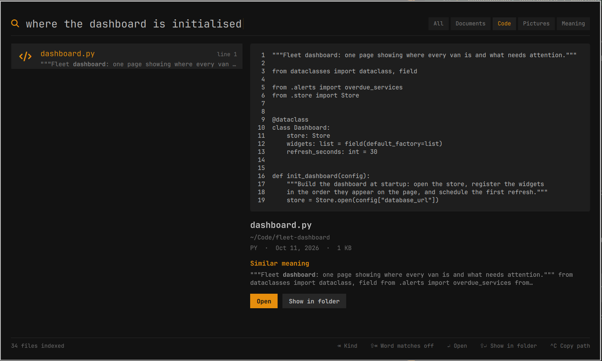
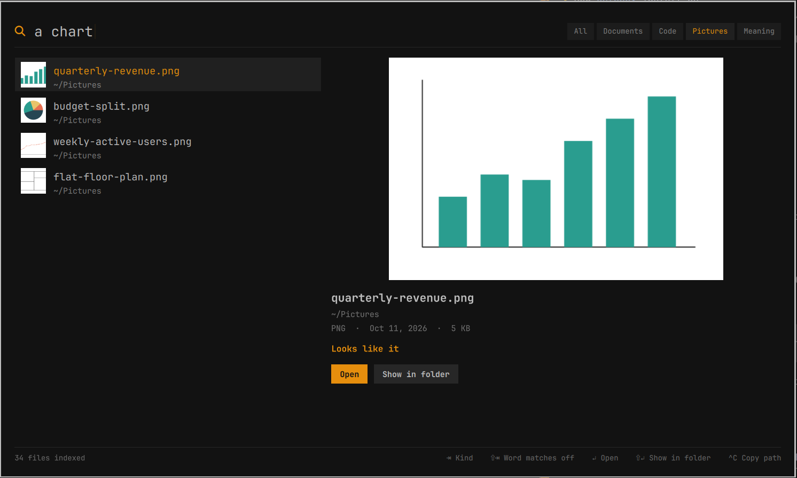

# Semantic search

A search overlay for the [Omarchy](https://omarchy.org) shell that finds
documents, source code and pictures by what they say, do or show, not only by
the words in them. Everything runs locally: [EmbeddingGemma 2](https://huggingface.co/google/embeddinggemma-2)
through [llama.cpp](https://github.com/ggml-org/llama.cpp), index in SQLite.


## Install

Needs Omarchy 4 on x86-64 and about 1 GB of disk. `uv` and `poppler` are the
only packages Omarchy does not already ship.

```bash
sudo pacman -S --needed uv poppler
omarchy plugin add https://github.com/depletionmode/omarchy-semsearch.git --enable
~/.config/omarchy/plugins/depletionmode.semsearch/install.sh
```

Then bind a key in `~/.config/hypr/bindings.lua`:

```lua
o.bind("SUPER + F4", "Semantic search", "omarchy-shell shell toggle depletionmode.semsearch '{}'")
```

A binding can open it already narrowed, for example to pictures:
`omarchy-shell shell toggle depletionmode.semsearch '{"kind":"image"}'` (`text` and
`code` work the same way).

Indexing starts straight away and you can search while it runs. It covers
your whole home directory, so the first run can take hours if you keep a lot
of source code there; it is resumable, and `roots` narrows it (see below).

`install.sh` needs no root. It downloads llama.cpp build `b11556` and the
EmbeddingGemma 2 `Q8_0` model (about 900 MB, each file checked against a
SHA-256 pinned in the script) into `~/.local/share/semsearch/`, then installs
and starts the `semsearch.service` user unit.

After `omarchy plugin update`, run `systemctl --user restart semsearch`.

## Remove

```bash
~/.config/omarchy/plugins/depletionmode.semsearch/uninstall.sh --purge
omarchy plugin remove depletionmode.semsearch
```

`--purge` also deletes the index, model and page cache
(`~/.local/share/semsearch`, `~/.cache/semsearch`).

## Use

| Key | Action |
|---|---|
| <kbd>↑</kbd> <kbd>↓</kbd> <kbd>PgUp</kbd> <kbd>PgDn</kbd> | Move through the hits |
| <kbd>Enter</kbd> | Open: a PDF at the matching page, source at the matching line |
| <kbd>Shift</kbd>+<kbd>Enter</kbd> | Show in the file manager |
| <kbd>Ctrl</kbd>+<kbd>C</kbd> | Copy the path |
| <kbd>Tab</kbd> | Narrow to documents, code or pictures |
| <kbd>Shift</kbd>+<kbd>Tab</kbd> | Also match literal words and file names (off by default) |
| <kbd>Esc</kbd> | Clear the query, then close |

A search is by meaning only until you press <kbd>Shift</kbd>+<kbd>Tab</kbd>, which adds
passages that contain your words and files whose path does. Each hit says why
it matched: it means something similar, it looks like what you described
(pictures), it has your words, or its name matches. A PDF opens in the preview
on the matching page with the passage highlighted.

The kind only filters; the same hits are found either way. Hits are listed
most similar first, whatever their kind, with word matches above them when
those are on.

| Code, by what it does | Pictures, by what they show |
|---|---|
|  |  |

From a terminal: `semsearch status`, `semsearch rescan`, `semsearch <query>`,
with `-w` to include word matches and `-k text|code|image` to narrow (in the
plugin folder).

## What is indexed

By default everything under your home directory:

- **Documents** (`pdf md txt org rst docx odt`), split into passages of about
  180 words.
- **Source code** (Python, JavaScript/TypeScript, Go, Rust, C/C++, Java and
  [more](semsearchd)), split at definitions into function-sized blocks.
- **Pictures** (`png jpg jpeg webp gif bmp tif tiff`), by what they show.
- **Paths**: folder and file names of the above.

Not indexed:

- hidden files and folders (`~/.ssh`, `~/.config`, `~/.cache`…);
- inside a git repository, anything git ignores, so no dependencies or build
  output;
- folders named `node_modules`, `__pycache__`, `venv`, `site-packages` or
  `vendor`, and `~/go/pkg`;
- files over 100 MB, source files over 300 KB or with minified lines, and
  pictures under 64 px.

Identical text is embedded once, so copies and extra worktrees cost little.
Changes are picked up live with inotify and take priority over a first index
still in progress. inotify is not recursive, so there is one watch per folder
a file could appear in: every folder outside repositories, and inside them
every folder git does not ignore. New folders are watched as they appear.
Everything is re-checked when the daemon starts.

## Configuration

Optional, in `~/.config/semsearch/config.toml` (defaults shown). Restart the
daemon after a change.

```toml
roots = ["~"]
# Folder names anywhere, or paths relative to a root when they contain "/".
exclude = ["node_modules", "__pycache__", "venv", "site-packages", "vendor", "go/pkg"]
extensions = ["pdf", "md", "txt", "org", "rst", "docx", "odt"]
image_extensions = ["png", "jpg", "jpeg", "webp", "gif", "bmp", "tif", "tiff"]
# code_extensions = [...]  see DEFAULTS in semsearchd
max_code_kb = 300
max_file_mb = 100
max_pages = 500            # of a PDF
gpu_layers = 99            # 0 keeps the model off the GPU
idle_unload_seconds = 300  # 0 keeps the model loaded
min_similarity = 0.35
min_image_similarity = 0.20
min_code_similarity = 0.35
```

The three `min_` values are the lowest similarity that counts as a match, as
tuned on an index of about 15,000 passages and 4,000 pictures. They are
scaled down for a smaller index and up for a larger one, by up to 30%.

## How it works

`semsearchd` embeds every passage, code block and picture and stores text and
vectors in `~/.local/share/semsearch/index.db`. A query is ranked against
each of the three (cosine similarity after subtracting that kind's mean
vector; code with the model's code-retrieval prompt) and listed by that
score. With word matches on, literal words (SQLite FTS5, no stemming) are
listed first.

The model is loaded on demand and unloaded after five idle minutes. Searching
loads only the text model (310 MB); the vision projector (555 MB) is loaded
while pictures are being indexed. With word matches on, a search is answered
with those alone until the model is ready. The overlay talks to the daemon over
`$XDG_RUNTIME_DIR/semsearch.sock`.

The daemon is a [`uv` script](https://docs.astral.sh/uv/guides/scripts/); on
first start `uv` installs `numpy`, `inotify-simple` and `pillow` into its cache.

## Limits

- **Relevance cut-off.** An embedding always has a nearest neighbour, so the
  daemon has to decide when the nearest one is not a match. The thresholds
  were tuned on one person's files: expect the odd unrelated hit, and the odd
  weak but correct match hidden. Picture matches are the less reliable half.
- No OCR for scanned PDFs. HEIC, audio and video are not indexed.
- Opening at the page or line works for Evince, Papers, Zathura and Okular,
  and for Neovim, Vim, Nano, Micro, Helix, Zed and VS Code; other viewers and
  editors open the file at its start.
- Embedding source code is slow, a few blocks a second, so a large code
  directory takes hours the first time.
- One llama.cpp build is offered: x86-64 with Vulkan.

## Privacy

The index holds the text of your documents and source files in plain SQLite
in your home directory. The daemon makes no network connections beyond a llama.cpp server
on a random `127.0.0.1` port; only `install.sh` downloads anything.

## Development

```bash
uv run --with numpy --with inotify-simple --with pillow --with pytest pytest tests/
journalctl --user -u semsearch -f
```

The overlay is `keepLoaded`: after editing `SemSearch.qml` run
`omarchy restart shell`.

## License

MIT. EmbeddingGemma 2 (Apache 2.0) and llama.cpp (MIT) are not redistributed
here; `install.sh` downloads them from their publishers.
